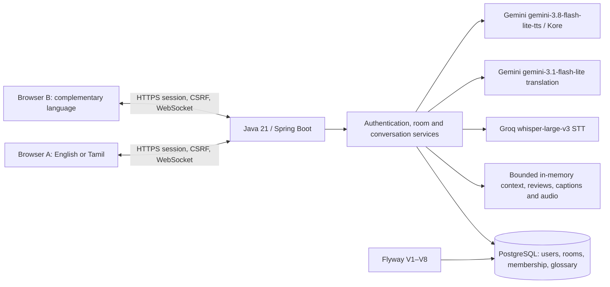

# VoiceLink architecture

## Submission component view

The Standard pipeline runs only when the separately configured free-tier guard and credentials permit it. The diagram shows the implemented flow, not proof of live provider quality or production deployment. HTTP/API details are in [API_REFERENCE.md](API_REFERENCE.md).

## Approved direction

The browser captures short microphone turns and displays captions and playback. Java/Spring Boot owns application logic, validation, authorization, room membership, bounded translation context, and room glossary behavior. Provider interfaces separate speech-to-text, translation, and text-to-speech services from orchestration. PostgreSQL persists accounts, rooms, and room glossary entries. WebSocket version 1 carries room and speech-turn events.

Current path: browser microphone → Java/Spring Boot → speech-to-text → bounded recent context and applicable room glossary → translation → captions → text-to-speech → recipient.

## Implemented in Gate 1

- Spring Boot entry point and package boundaries.
- Temporary Thymeleaf foundation page and Actuator health endpoint.
- Spring Security allowlist for those two endpoints and deny-all fallback.
- PostgreSQL local Compose definition, environment-based configuration, JPA validation mode, and Flyway enabled.
- In-memory database foundation tests.

## Gate 2B account foundation

Flyway V1 creates `users` and `user_preferences` in one migration. `users.id` is a UUID primary key; `email` is normalized in application code and protected by a named unique constraint. `user_preferences.user_id` shares the account UUID and has a foreign key with `ON DELETE CASCADE`. Language tag columns are nullable strings so registration begins with unset preferences and later gates can support languages beyond the initial planned English (`en`) and Tamil (`ta`) pair. Hibernate validates the migration-created schema; it does not generate it.

Registration uses a dedicated form, central email normalization, Bean Validation, a transactional service, and one preferences row per new account. Password length: 10–128 characters. Passwords are encoded before persistence; the database stores only the encoded value. The selected encoder is Spring Security 7.1.1's `Argon2Password4jPasswordEncoder`, using Password4j 1.8.4 because the supported adapter requires it. Configuration is Argon2id, 65,536 KiB memory, three iterations, one lane, 32-byte output, and a 16-byte random salt. No custom hashing algorithm is implemented.

Spring Security uses a database-backed `UserDetailsService`, form login with `email` as the username field, and server-side sessions. The trusted principal carries the user UUID. Login failure messages are generic; disabled accounts cannot authenticate. Session fixation protection changes the session ID on authentication. POST logout invalidates the session and deletes its cookie. CSRF protection remains enabled, including login, registration, and logout forms. At Gate 2B, `/app` and future `/rooms/**` and `/api/**` paths required authentication, while `/ws/**` was denied. Gate 4B's exact live endpoint exception is described below; all other unlisted routes remain denied. The public root and health routes remain for foundation checks.

At Gate 2B this was a controlled development/demo identity boundary without email verification, password recovery, request throttling, production session cookie/TLS deployment configuration, or account administration. Current password recovery is described below; email verification and request throttling remain separate work before unrestricted public identity use.

## Password reset enhancement

Only the production profile may use the real Resend sender. Offline tests use a capturing sender, and enabling recovery in a local profile is rejected.

Password recovery is disabled by default. When enabled with a configured HTTPS public origin and Resend HTTPS email credentials, the login page offers a forgot-password flow. Known and unknown account requests receive the same acknowledgement. A 32-byte random, unpadded Base64URL token is sent only in a reset email; Flyway V5 stores one SHA-256 token hash per account, with a 30-minute expiry. Issuing a new token replaces the old one. Successful use changes the Argon2id password hash and deletes the token. The link carries the token in a URL fragment, which local JavaScript removes from browser history and submits in a CSRF-protected form. No reset link is built from an incoming Host header.

After reset, authenticated HTTP sessions holding the previous password hash lose access on their next request; active room WebSockets are closed after commit and also check current account credentials. This uses the existing single-instance session model. On 2026-10-16 the owner reported a successful production forgot-password, Resend email, reset-link, password-change, login, and dashboard browser sequence. Codex did not make a live email call; the reported Chrome warning remains a separate browser/security-review item.

## Planned, not implemented

Persisted conversation messages/history and broader context beyond the approved bounded memory window remain outside the implemented scope.

## Gate 7B room service profiles

Flyway V4 adds `conversation_rooms.service_profile` with a `STANDARD` default and a database check for `STANDARD` or `PREMIUM`. The creator selects the immutable room profile; both members see the stored choice. Speech requests, WebSocket frames, join, and glossary operations cannot select a provider. The room authorizer reads the stored profile, and `AiProviderResolver` chooses a bundle for the existing serial `SpeechTurnService`. Both bundles share one Groq `whisper-large-v3` STT adapter and the same bounded context, glossary, turn ordering, events, temporary WAV, and partial-result pipeline.

Standard keeps Gemini `gemini-3.1-flash-lite` translation and `gemini-3.8-flash-lite-tts` voice with the Standard key. Premium uses a separate billed-project key for Gemini `gemini-3.8-flash` translation with low thinking and `gemini-3.8-flash-tts` with Kore voice. Premium is disabled by default and requires server enablement plus a nonblank separate key. The server checks the stored profile and availability before each paid translation and TTS stage; adapters check the Premium key again before sending. No automatic cross-profile fallback exists. A disabled Premium translation leaves the transcript; a failed TTS leaves transcript and translation. An external request already sent cannot be retracted. No real Premium call, billing setup, or English/Tamil quality and latency validation is claimed; Google Cloud STT and Chirp remain researched alternatives.

## Gate I operational Premium and API Cost Saver

Flyway V7 adds immutable `conversation_rooms.premium_cost_saver_enabled`, defaults existing rooms to `TRUE`, and prevents a Standard row from carrying an OFF value. Premium room creation accepts only ON or OFF while the server is enabled and the separate Premium Gemini key is nonblank. Standard creation always stores the safe default. Runtime authorization reads both profile and Cost Saver state from PostgreSQL; browser fields and request parameters cannot change them after creation.

Cost Saver ON uses a 1,500 ms Premium text-preview debounce and server minimum interval. OFF uses 800 ms. An exact completed same-revision review is reused, and an identical in-flight review is rejected before another provider invocation. Existing speech idempotency and serial room work preserve one final translation and one TTS job; abandoned Finish & Send reviews never synthesize audio. Both modes retain `gemini-3.8-flash`, low thinking, the Natural Conversational prompt, bounded context/glossary, and `gemini-3.8-flash-tts` with Kore. Cost Saver does not select a cheaper model or weaken Total Translation.

`PremiumUsageGuard` applies only to stored Premium rooms. Defaults are eight translation requests per user, 16 per room, and 40 per instance per rolling minute; TTS defaults are six, 12, and 24; at most two paid Gemini operations run concurrently. Operators may lower or raise these validated limits through the documented environment settings. Accepted, completed, failed, throttled, and token-unit metrics use only finite operation/outcome/Cost Saver labels. Translation token counts are recorded only when Gemini supplies numeric usage metadata. They are measured usage units, not estimated cost or actual billing. No pricing estimate or billing balance is shown.

All limits are process-local and reset on restart. They are appropriate for the current single-instance monitored campus deployment, not an unrestricted multi-replica service. Shared distributed accounting and provider billing alerts are still required before claiming a spending cap. Premium remains disabled by default, has no Standard fallback, and is not operationally validated until a separately authorized paid live test succeeds.

## Gate 3B two-person room foundation

Flyway V2 creates `conversation_rooms` and `room_participants`. A room has one creator in participant slot 1 while `WAITING`, and becomes `ACTIVE` only when a second authenticated user joins slot 2. A unique `(room_id, participant_slot)` constraint limits membership to two; a pessimistic room-row lock serializes competing joins. A separate unique `(room_id, user_id)` constraint prevents duplicate membership. The application transaction maintains the `ACTIVE`-means-two invariant. Room and participant rows remain after closure for later history support.

The creator chooses `en` → `ta` or `ta` → `en`; the joiner's reverse direction is stored in their own participant row. These room-specific values are snapshots independent of later preference changes. The database does not hardcode the current language pair. Authenticated principal UUIDs establish identity, and a central membership service checks private room access. Direct unknown and non-member room UUIDs receive the same not-found response.

A 16-character random code is manually shared and entered by an authenticated joiner. It is an invitation rather than an authentication credential, and is never placed in a URL. The code expires 24 hours after room creation while `WAITING` and becomes unusable once the room is `ACTIVE` or `CLOSED`. Invite age does not close an `ACTIVE` room. The creator can cancel a waiting room; either active member can explicitly leave, which closes it for both. Refresh, logout, browser closure, and network loss do not close rooms. Closed rooms cannot reopen. A join-attempt limiter is deferred for the controlled demo; public deployment requires abuse-rate controls.

Flyway owns schema changes; Hibernate validates rather than generating schema. The health endpoint includes database connectivity when the application is started with a working database connection. H2 tests alone do not establish PostgreSQL compatibility; the separate Testcontainers path must be run against PostgreSQL 17.

## Gate 4A approved; Gate 4B live transport

Gate 4A approved a raw Spring WebSocket endpoint at `/ws/rooms/{roomId}`. The browser reuses its authenticated HTTP session. The handshake derives the user UUID from `AccountPrincipal`, checks PostgreSQL room membership and status, and applies Spring's same-origin policy. Other `/ws/**` paths remain denied. A member of a `WAITING` room may connect to receive `ROOM_STATE` but cannot send text. An `ACTIVE` member may send temporary text. A `CLOSED` room rejects new sockets.

Each live room has an in-memory stream UUID and increasing sequence. Version 1 server events are `ROOM_STATE`, `TEXT_MESSAGE`, `ROOM_CLOSED`, and private `ERROR`. The server assigns event IDs, trusted participant identity, room sequence, and turn IDs. A verified connection is bound to one room; at most one current socket exists per member per room. An old socket's close callback cannot remove its replacement. Browser text is rendered as text, never HTML.

Room activation and closure notifications are delivered only after their database transactions commit. Room publication is serialized so a concurrently accepted text event may precede `ROOM_CLOSED`, but no text event is published afterward. Logout and reported servlet session destruction close associated sockets; live sends also check the existing HTTP session. Exact timeout notification timing depends on the servlet container.

Events and temporary text are transient. Reconnect performs a fresh authenticated handshake and receives current `ROOM_STATE`; it does not replay missed text or automatically resend uncertain text. A restart resets in-memory streams and sequence values, distinguished by a new stream UUID. There is no message, event, presence, or WebSocket-session table. Gate 5A approved bounded authenticated HTTP upload for push-to-talk turns with WebSocket result events. Flyway V3 was added later for the room glossary, as described below.

## Gate 5A approval and Gate 5B Standard speech foundation

The owner approved the 2026-10-08 provider research in [AI_PROVIDER_EVALUATION.md](AI_PROVIDER_EVALUATION.md). Gate 5B originally used provisional Azure translation/TTS adapters. After repeated owner Azure account/payment-card verification failures, the Standard mapping was revised before live validation. It now uses Groq Free `whisper-large-v3` STT, Gemini API Free Tier `gemini-3.1-flash-lite` translation, and Gemini API Free Tier `gemini-3.8-flash-lite-tts` with documented `Kore` voice and WAV output. The profile is fixed server-side. It has no paid fallback, no Premium runtime path, and no provider credentials in the database or browser. The operator must explicitly confirm Groq Free and Gemini API Free Tier before enabling calls; the flag does not itself verify billing status. Gemini Free Tier content may be used by Google to improve its products, so development use is limited to non-sensitive, non-confidential speech.

An ACTIVE member sends a maximum 1 MiB WebM/Opus turn through CSRF-protected `POST /api/rooms/{roomId}/turns`. The server derives identity and English/Tamil direction from the authenticated principal and stored room participant. It ignores browser-supplied identity and language fields. A single-instance bounded worker processes turns serially per room: STT, source caption, translation, target caption, TTS, authenticated audio reference. Provider calls occur outside database transactions and WebSocket publication locks. `turnIndex` is acceptance/playback order; WebSocket `sequence` remains publication order. New version 1 event types are `TURN_ACCEPTED`, `TRANSCRIPT_READY`, `TRANSLATION_READY`, `AUDIO_READY`, and `TURN_FAILED`.

Raw uploaded bytes are dropped after STT. Audio is available to ACTIVE room members from a no-store endpoint for five minutes, with a 16 MiB global audio cap; recent in-memory turn state expires after ten minutes. One runtime keeps at most 32 room states, four pending turns per room, 16 recent turns per room, and 128 bounded idempotency IDs per room. Closed rooms discard state. The idempotency window and temporary state do not survive restart. A recent-turn endpoint helps a reconnecting browser recover current captions, but this is not durable conversation history.

Gate C1 reclaims a room speech queue after its terminal turns and idempotency entries expire, its audio has expired, and it has no queued or running work. Cleanup runs every 60 seconds and opportunistically before new acceptance, under the same service lock. In-flight or queued work and downloadable audio prevent eviction. The 32-room cap still rejects simultaneous rooms with unexpired temporary state; it no longer fills permanently with historic idle rooms. After complete idle eviction, a later turn in the same still-open room begins a new temporary `turnIndex` epoch at 1, like a process restart. Replayed request IDs after the temporary idempotency window can start a new turn. The browser should refresh its temporary recent-turn view after prolonged inactivity.

Gate C1 also limits accepted speech turns with an instance-local monotonic sliding 60-second window: 12 per authenticated user and 60 across the instance by default. `VOICELINK_SPEECH_MAX_TURNS_PER_USER_PER_MINUTE` and `VOICELINK_SPEECH_MAX_TURNS_PER_INSTANCE_PER_MINUTE` may lower or raise these values within the validated global ceiling of 1,000; the global setting must be at least the per-user setting. Duplicate request IDs already in the temporary cache return their original turn without consuming another allowance. New requests over either limit receive HTTP 429 and a non-sensitive wait message before provider work. The existing two workers, 16 queued room tasks, four pending turns per room, 1 MiB/15-second upload checks, 16 MiB audio cache, 32-room cap, and provider configuration guards remain. A turn can cause at most one STT, one translation, and one TTS call; these are application safeguards, not provider quota guarantees. Multi-instance deployment would require shared rate/accounting and shared session/room state before scale-out.

Micrometer keeps bounded-cardinality counts (`received`, `accepted`, `rate_limited`, `ready`, `failed`, `discarded`) and monotonic server durations (`queue_wait`, `stt`, `translation`, `tts`, `caption_event`, `audio_event`, `end_to_end`) tagged only by finite profile and event/stage labels. A discarded turn means the room became unavailable while processing. Caption/audio event durations end when the server publishes each event; they do not claim browser visibility or playback. Only `/actuator/health` is exposed over HTTP, so these measurements are internal until an approved operations sink is configured. No transcript, translation, provider body, audio, room/user ID, or key is a metric tag. The approximately 3–7 second short-turn target is for later live measurement, not a guaranteed SLA or a benchmark result.

The existing immutable `TranslationRequest` already accepts current text, explicit direction, bounded reference context, and room glossary terms. This permits a later authorized text workflow to reuse the Gemini adapter and Natural Conversational instruction. Text entry points will need their own membership, CSRF/WebSocket, rate, draft-lifecycle, and privacy design; Gate C1 adds none of them.

For unrestricted public use, further work is required: account creation, login/recovery, room creation and invite attempts need dedicated abuse controls; the live WebSocket stream map currently retains metadata for disconnected open rooms until explicit closure; the single-instance turn limiter is not a distributed quota system; and the WebM header/duration check does not decode every adversarial recording. These are real residual availability and cost risks, so the current controls support a monitored single-instance campus demonstration rather than an unrestricted public release. None justifies claiming that the existing Standard or Premium adapter silently falls back, exposes a key to the browser, or persists transcripts; current source and offline tests reject those concerns.

Browser capture has a 15-second stop timer and checks `MediaRecorder.isTypeSupported` before recording. The server checks size, declared duration, WebM signature, and WebM/Opus markers, and rejects excessive embedded duration when present. Full media decoding is outside this gate, so malicious low-bitrate overlong input remains a residual risk. At Gate 5B, the Standard pipeline used no context or glossary and reserved empty translation inputs. The owner has not yet reported live English/Tamil provider or integrated microphone quality evidence.

Default translation style: **Natural Conversational**. Designed behavior: the Gemini system instruction names the source and target language explicitly; asks for natural spoken English or Tamil while preserving actual meaning, intent, tone, politeness, question/statement intent, and appropriate technical or proper terms; and forbids forced literal word order, added or omitted meaning, explanations, commentary, markdown, and answering instead of translating. The adapter still accepts only the structured `translation` field. Unverified quality: actual English/Tamil naturalness and meaning preservation still require live human review; offline request tests verify the instruction contract, not Gemini output quality.

## Gate 6A approval and Gate 6B bounded context and room glossary

The owner approved memory-only context and a PostgreSQL room glossary at Gate 6A. The per-room serial speech worker snapshots prior source transcripts after STT and before translation. Only turns with a valid completed translation qualify, including a turn whose TTS later failed. It uses at most the newest three prior turns, no older than five minutes, at most 400 Unicode code points per turn and 1,200 combined, in oldest-to-newest turn-index order. Oversized turns are omitted whole. STT and translation failures, the current turn, and other rooms are excluded. Room closure clears in-memory state after commit; restart loses it. There is no conversation transcript/history table.

Flyway V3 adds `room_glossary_entries`, scoped to `conversation_rooms`, with a unique normalized source per room and direction, creator foreign key, `row_version`, and cascade on room deletion. Service validation limits a room to 12 entries and source/preferred terms to 48/64 Unicode code points. Terms are NFC-normalized, trimmed, and whitespace-collapsed; source uniqueness uses locale-independent lowercase. A blank preferred input stores the display source term as an explicit preserve-source preference. The waiting creator may edit while the invite is valid; either active member may edit; expired waiting rooms are read-only and closed rooms deny access. Room closure deletes glossary rows in the same transaction. Mutations lock the room row for capacity/lifecycle ordering; entity versioning and expected versions reject stale edits.

The member-only `/api/rooms/{roomId}/glossary` GET/POST and `/{entryId}` PUT/DELETE endpoints derive identity from the authenticated principal, enforce CSRF for mutations, cap JSON mutation bodies at 4 KiB, and resolve entries by both room and entry ID. Responses use no-store; the browser renders terms through `textContent` and refreshes from the server. The room page has only a minimal terminology control, not transcript history. Direction-matching terms are sent to translation only when they match the current utterance as whole phrases; Latin matching is case-insensitive and longer overlapping terms win. Tamil morphology may require conservative exact phrase boundaries, so some inflected occurrences may not match.

Gate 6C closes a browser-state race: a room-close WebSocket event or reconnect state check clears the glossary list and form, and a pending glossary refresh cannot repopulate terms after closure. The form now explains the Unicode term limits and gives a safe, clearer validation message. This behavior has code review and automated syntax evidence, while owner browser observation remains pending.

The immutable translation request carries the current utterance, explicit language direction, bounded context, and applicable glossary terms, never persistence entities or user identity. Gemini receives these as separate structured data fields. The system instruction treats all speech and glossary text as untrusted reference data, translates only the current utterance, and retains Natural Conversational style and structured output. This reduces prompt-injection risk but does not guarantee immunity. The worker holds no database transaction or broad state lock during provider calls. A provider request already in flight at closure may complete; its result is not published to the closed room. Closing a room cannot retract data already sent to providers.

Gemini Free Tier may receive more user data than before: up to three prior source transcripts and applicable room glossary terms as well as the current utterance. Standard/free development remains limited to non-sensitive, non-confidential conversations. Do not log context, glossary contents, raw prompts, provider bodies, transcripts, translations, audio, or keys. Actual English/Tamil quality and provider behavior remain unverified by live human review.

## Gate 8B professional interface

Gate 8A approved a light-only warm-white/deep-ink/teal system with restrained violet Premium accents. Gate 8B follows the owner-selected Claude prototype concept as the primary visual direction with Gemini-style restraint, implemented against real VoiceLink behavior rather than prototype controls. Gate 8B uses one local stylesheet at `/css/voicelink.css`, the existing Thymeleaf templates, and vanilla JavaScript. There is no frontend framework, asset build pipeline, remote font, or external icon dependency. A minimal original inline SVG mark accompanies readable VoiceLink text. The responsive layout keeps the active two-person conversation foremost: room and connection state, participant language directions, push-to-talk recording, live original and translated captions, and authenticated temporary audio playback. The room glossary is a native collapsible secondary panel, beside the conversation from 960px upward and in flow on smaller screens. Mobile layout supports 320px widths; focus states, touch targets, field feedback, language-tagged captions, status announcements, and reduced-motion handling are included.

Existing server routes, form fields, CSRF tokens, room membership checks, immutable profile routing, bounded context, glossary API, WebSocket events, and temporary audio are unchanged. The only backend presentation change allows public GET access to the exact stylesheet path so public sign-in and registration pages can load it; the deny-by-default security boundary otherwise remains. Browser scripts use DOM text nodes and safe attributes for participant names, captions, messages, glossary terms, and errors. Recording requires a live room connection and supported WebM/Opus capture; a connection loss discards an in-progress recording before upload. Closed-room events clear transient caption and live-text DOM content. The UI does not add persistent transcript or audio storage.

The create-room disclosure names Standard free-tier quotas and Premium paid Gemini translation/voice with shared Groq recognition, without claiming measured quality or total privacy. Manual visual/browser review and real English/Tamil provider quality remain pending; static and offline tests do not establish how the interface looks or behaves in every browser.

## Gate 10A deployment configuration

The approved target is one Railway native Java 21 service with a private PostgreSQL service. The common server port resolves `PORT` before the local `SERVER_PORT` override and then 8080. The app requires explicit JDBC `DB_URL`, `DB_USERNAME`, and `DB_PASSWORD`; Railway PostgreSQL service variables are referenced to construct the JDBC URL, not passed as a non-JDBC `postgresql://` URI. Flyway V1–V4 still runs at startup and Hibernate validates the schema. The production profile adds only trusted-proxy forwarded-header handling, Tomcat proxy redirect handling, cookie-only session tracking, and `Secure`/`HttpOnly`/`SameSite=Lax` session cookies. The local HTTP profile remains unchanged. CSRF, deny-by-default authorization, same-origin WebSocket handshakes, and `/actuator/health` status-only exposure remain intact.

One runtime is required because HTTP sessions, WebSocket streams, bounded context, transient captions, turn state, and generated audio live in memory. Redeploy or restart clears them; PostgreSQL accounts, rooms, and open-room glossary rows survive. Audio is never written to a production volume or object store. Standard provider calls still require confirmed free-tier status and both credentials; Premium remains disabled without explicit paid enablement and a separate key. These configuration statements are design and offline evidence only: real Railway build, proxy/cookie behavior, PostgreSQL SSL, outbound provider access, memory limits, and integrated browser/live quality await later owner deployment and QA.

## Account deletion dependency graph

`users` owns `user_preferences` and `password_reset_tokens` through database `ON DELETE CASCADE`. `conversation_rooms.created_by_user_id`, `room_participants.user_id`, and `room_glossary_entries.created_by_user_id` are restrictive foreign keys. A room also owns participants and glossary rows. JPA does not cascade account deletion through those relationships. The deletion transaction locks the account, gathers created and joined rooms, closes open rooms with the existing lifecycle, clears room glossary, removes departing memberships, removes rooms created by the account because their non-null creator reference cannot survive, then deletes the account. Rooms created by another member remain closed and visible to that member. Created rooms are removed for all members; their active sockets still receive the room-close event after commit. Reset tokens and preferences cascade with the account row. After commit, the account session registry invalidates known HTTP sessions and the live hub revokes account sockets. Existing credential checks reject any stale session or socket that was not registered in memory. This design uses V1–V5 unchanged and does not persist transcripts or audio.

## Closed-room list removal

Flyway V6 adds nullable `room_participants.removed_at`. A member may remove only a CLOSED room from their own list through an authenticated, CSRF-protected POST. The service locks the room, checks current membership and CLOSED status, and marks only that member's participant row. Room lists and direct room access exclude removed memberships; the other member's row and room remain. This is a per-member dismissal rather than room deletion or an active-room close action. Account deletion still sees all participant rows, including previously dismissed ones, so its room cleanup remains complete. No conversation transcript or audio is stored by this feature.

## Gate D total text translation

The active room offers Speak (default) and Type. Typing does not call a provider, publish to the partner, or update context. Type uses authenticated, CSRF-protected, no-store `POST /api/rooms/{roomId}/text/reviews` for explicit Translate. The server derives room membership, current participant direction, stored STANDARD/PREMIUM profile, applicable room glossary, and bounded context. It calls only the profile's existing Gemini translation adapter, preserving the Natural Conversational prompt. Premium retains its separate server-side paid configuration guard and is disabled by default; there is no fallback. Source text is limited to 1,000 Unicode code points, rejects blank input, lone surrogates, and control characters, and its JSON request body is limited to 8 KiB. The browser never receives provider credentials.

Each successful review is held only in instance memory for **two minutes**. The unpredictable review ID binds the authenticated user, HTTP session, room, exact source text, translated result, direction, profile, client revision, glossary snapshot, and expiry. A new Translate for that user and room replaces the previous review. Server generation checks reject a slower old result after a newer request. At most 32 rooms have review state, each member has at most one stored review and two concurrent Translate requests, and at most 16 Translate requests can be in flight across the instance. A scheduled cleanup and request-time cleanup expire reviews; room closure clears them after commit. A browser edit or mode change invalidates the visible review immediately, and Send checks the exact source and revision again on the server. A changed glossary invalidates a pending review and requires Translate again. Review data is never sent through WebSocket and is lost on restart. The provider and server do process the private review; “private” means only that the partner cannot see it before Send.

`POST /api/rooms/{roomId}/text/send` resolves the server-stored review after fresh active-member, session, direction, profile, source, revision, glossary, and expiry checks. It accepts one finalization and returns the same final ID with `duplicate=true` for a retry within the review lifetime. Only the first accepted Send adds the source text to context and publishes `TEXT_TRANSLATION_SENT` through the existing version 1 raw WebSocket envelope and sequence. The event contains the bounded original and translated text, explicit direction, and profile; participant identity is server assigned. Both currently connected authorized room members receive it without refresh. The browser uses text nodes, deduplicates by final ID, and retains only a bounded recent display. If a participant is disconnected, the event is missed: there is **no persistent offline delivery or replay**. Existing untranslated `TEXT_MESSAGE` remains a separate temporary feature and is labeled accordingly.

The in-memory shared context now receives translated speech turns and explicitly sent text turns in finalization order. It still selects at most three source utterances from the last five minutes, at most 400 Unicode code points each and 1,200 combined. Failed speech translations, unsent text reviews, and closed rooms do not contribute. Context, reviews, sent-text display, and WebSocket streams are instance-local and lost on restart; PostgreSQL stores only the existing room glossary and account/room data. Glossary entries are still limited to 12 per room and deleted on explicit room closure. Server-side text Translate uses an independent monotonic one-minute limiter, default **8 per user** and **40 per instance**, configurable with `VOICELINK_TEXT_MAX_REVIEWS_PER_USER_PER_MINUTE` and `VOICELINK_TEXT_MAX_REVIEWS_PER_INSTANCE_PER_MINUTE`. HTTP 429 occurs before provider work. These controls support the current single-replica demonstration and are not a distributed public-use quota system.

## Gate E live private text translation

Type now has a secondary **Live / Total** choice while Speak / Type remains the primary control. Total remains the default and preserves explicit Translate. Live Private waits for a page-configured 800 ms pause after input, ignores empty, oversized, and active IME-composition text, and posts the current source and client revision to the same authenticated review endpoint. It has no automatic retry. Unchanged input does not create another automatic request. The existing shared text limits of eight reviews per user and 40 per instance per rolling minute remain authoritative and aggregate Live and Total provider use; Live can therefore receive HTTP 429 after repeated pauses. This deliberately favors a predictable single-instance cost ceiling over aggressive preview frequency.

Every input, mode, glossary, expiry, or room-lifecycle change increments the client revision, clears Send, cancels the debounce, and aborts an outstanding fetch when supported. Abort is only a browser resource optimization: the server's generation, concurrency, rate, and bounded review checks remain authoritative because provider work may already have begun. A response can update the preview only when its revision, source text, room state, primary mode, and Live/Total mode still match. Live completion does not move focus away from the editor. Total completion retains its existing review focus behavior. Tamil IME composition schedules a request only after `compositionend` and the full debounce.

Live reuses the Gate D server-held review and explicit Send path without a new store, endpoint, provider, model, WebSocket event, or database migration. Drafts, in-flight text, successful private previews, errors, and abandoned previews are never published or added to context. Only finalization emits `TEXT_TRANSLATION_SENT` and adds the source utterance to bounded context. The browser renders preview fields with `textContent`; the server and configured Gemini provider still receive the draft selected for translation. A small glossary browser signal invalidates visible reviews when refreshed entries change, while the server glossary snapshot remains the final authority at Send. Shared Live, progressive speech recognition, automatic sending, persistent transcript history, and paid-provider activation remain outside Gate E.

## Gate F shared live text translation

Live text retains **Private Preview** as its default. A member must deliberately select **Shared Live**, after which a CSRF-protected authenticated mutation creates an in-memory authorization bound to the active room, user, participant, HTTP session, random sharing epoch, stable draft ID, and 120-second sliding expiry. There is at most one sharing authorization for a user in a room and at most 64 across one application instance. A second session for the same account replaces and clears the earlier session's draft. No sharing authorization or draft is stored in PostgreSQL.

Shared Live reuses the existing text review pipeline, Gemini provider selection, glossary, bounded finalized context, two-minute review, concurrency bounds, and one-minute limits of eight reviews per user and 40 per instance. The browser sends its raw source only to the authenticated review endpoint after the existing 800 ms pause. The server derives direction and profile, obtains the translation once, and publishes only that provider-produced translated field after the sharing epoch, session, participant, revision, room state, language direction, and current socket are rechecked. Broadcast does not make another provider call. A content-free revision invalidation reaches the server on the first edit after an active shared request; once received, an older provider result cannot publish. Network transit still means an edit is unknowable to the server until that invalidation arrives.

Protocol version 1 adds peer-only `TEXT_DRAFT_UPDATED` and `TEXT_DRAFT_CLEARED` events within the existing stream/event/sequence envelope. An update contains translated text, explicit source and target languages, a stable draft turn ID, increasing revision, provisional status, and expiry. It excludes raw source, review ID, sharing epoch, session ID, context, and credentials. The receiver replaces one temporary draft instead of appending history. The browser renders it with `textContent` and ignores an older revision. A separate restrained live region announces draft start and meaningful clearing without announcing every revision.

Opt-out, switching to Private/Total/Speak, input clear, successful finalization, sender disconnect, session revocation, account/reset revocation, expiry, and room closure invalidate sharing. Where an authenticated peer can still receive it, the server emits a clear after the last published revision. A successful Send first clears the provisional draft, then uses the existing idempotent `TEXT_TRANSLATION_SENT` publication and adds only that finalized source utterance to bounded context. Drafts, failed work, cleared work, and private reviews never enter context.

Reconnect is fail-closed: socket loss resets the sender to Private Preview and clears the receiver's local draft; the old epoch is not restored. A new connection receives current room state without draft replay. Scheduled pruning clears expired published drafts. Application restart loses all sharing authorizations and drafts. Clearing can remove the current screen state but cannot erase content a participant already saw or copied. The design remains single-replica and instance-local; it adds no broker, database migration, model, fallback, or paid-provider activation.

## Gate G speech Finish & Send

Speak retains **Live Send** as the default complete-turn workflow. Live Send accepts one completed WebM/Opus upload, immediately enters the existing bounded room worker, publishes the established caption stages, adds the translated turn to bounded context, and generates temporary translated audio. It remains a complete-recording flow rather than progressive microphone streaming.

**Finish & Send** uses the same validated audio upload, rate limits, server-derived language direction, room profile, glossary selection, bounded finalized context, STT adapter, translation adapter, and per-room worker. Its completed recognition and translation are held as a private server review instead of being published. The review is bound to an unpredictable turn ID, authenticated account, HTTP session, room, language direction, immutable room profile, and glossary snapshot. A sender-only no-store status endpoint returns the recognized and translated text. Reviews expire after 120 seconds, remain bounded by the existing 32-room and 16-turn temporary state limits, are scrubbed on cancellation or eviction, and disappear on restart. A cancelled, expired, closed-room, or revoked-session review cannot be retrieved or finalized.

Explicit Send rechecks active membership, current session connection, direction, profile, glossary snapshot, expiry, and cancellation under the speech-state lock. The first accepted Send adds the source transcript to the shared bounded context once, publishes the established final speech caption events, and queues one TTS task through the same room-serial worker. Concurrent or repeated Send returns the already accepted finalization without another context entry, public caption, or TTS call. A glossary change rejects the stale review and requires a new recording. If TTS fails after Send, the finalized captions remain and the existing speech failure event reports the audio-stage failure without duplicating the message.

No private review, review status, or review identifier is published to the room WebSocket. The peer and other rooms receive nothing before explicit Send. The browser polls only the authenticated sender endpoint at a fixed 750 ms interval for at most 80 attempts, renders text with `textContent`, and invalidates an outstanding review on Cancel, Record Again, or a switch away from Finish & Send. Recording remains capped at 15 seconds and 1 MiB, speech limits remain 12 accepted uploads per user and 60 per instance in 60 seconds, and Premium remains disabled unless its existing server-side paid configuration gate is satisfied. There is no persistent transcript, audio, or review migration.

## Final Standard integration: participant setup and conversation workspace

The local `release/standard-final` branch contains J5A/J5A.1 and J5B1 through Git ancestry. Flyway V8 adds a nullable, validated `room_participants.conversation_display_name`; existing rows remain valid and display the account name as a fallback. New room creation accepts a 1–48 code-point conversation name and a supported creator speaking language. The server assigns the partner the complementary English/Tamil direction and derives Conversation Owner from `conversation_rooms.created_by_user_id`. The two-step invite preview shows the owner's conversation name and speaking language only after an authenticated valid-code check. Neither a display name nor a browser-supplied owner flag grants room access.

The room workspace identifies You and Partner from server-authoritative participant IDs and displays both speaking and receiving directions. Its temporary unified timeline distinguishes original/translated speech, untranslated text, provisional Shared Live drafts, and final sent translations. WebSocket event IDs and sequence numbers support duplicate suppression and arrival-order rendering; they do not promise persistent or creation-time ordered history. Refresh/reconnect starts a new temporary view. Speak retains Live Send and private Finish & Send; Type retains Total, Private Live, Shared Live opt-in, explicit Send, and safe manual Retry. User and provider text is inserted with text APIs rather than HTML interpolation.

Standard retains Groq `whisper-large-v3`, Gemini `gemini-3.1-flash-lite` translation, and Gemini `gemini-3.8-flash-lite-tts`. Its structured translation instruction now emphasizes conversational meaning, tone, questions, suitable Latin-script technical terms in Tamil, and glossary constraints that cannot override current intent. The recent-context and room-glossary bounds remain unchanged. Offline request tests verify the instruction contract, not actual provider quality. Premium is a separate disabled mode with no automatic fallback; no paid call or live Premium quality claim is part of this release.
