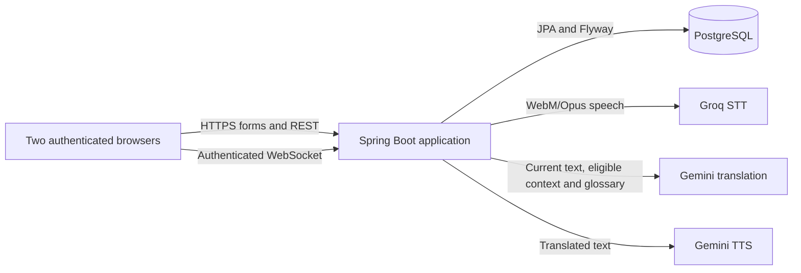

# VoiceLink architecture

## Runtime overview

VoiceLink is a single-instance Spring Boot application. Thymeleaf renders pages; local CSS and vanilla JavaScript provide the interface. Spring Security owns the authenticated session, CSRF protection, and route rules. PostgreSQL stores account, room, participant, and room-glossary records; Flyway owns schema changes. REST endpoints handle forms, room operations, glossary updates, translation review/send/retry, and temporary audio. An authenticated same-origin WebSocket carries room state, Quick chat, and speech-turn events.

## Conversation flow

The room creator selects a speaking language; the server assigns the complementary English/Tamil direction to the joining participant and derives identities from authenticated membership. A room has at most two participants. Browser-provided names, language selections, room IDs, and invite codes are inputs, not authorization. Every protected REST and WebSocket operation checks current membership and room state.

Speech turns are bounded WebM/Opus uploads. The server checks membership and media metadata, sends audio to Groq with the selected source language and bounded source-language glossary hints, translates the transcript through the room's resolved provider profile, and may generate target-language audio. Translate Message keeps translation review private until explicit Send. Shared Live is a separate opt-in workflow: one authenticated live draft is visible to both room participants while it is being composed. A newer accepted revision replaces the current draft; editing or clearing input invalidates the prior revision and clears its published draft when accepted. The sender must explicitly Finish the live message to finalize it into the conversation; provisional drafts are not final conversation messages. Idempotency identifiers and event IDs suppress duplicate delivery. After successful recognition but failed translation, the sender may deliberately retry translation using the same in-memory turn and transcript; the partner sees the turn only after translation succeeds. The retry does not repeat speech recognition or create a second turn.

The unified timeline uses server participant identifiers for attribution and safe DOM text insertion. Event sequence numbers represent publication order within the running process, not a durable globally ordered history. Refresh/reconnect does not replay text messages; bounded recent speech state may be restored while it remains in memory.

## Provider profiles and privacy

Standard uses Groq `whisper-large-v3`, Gemini `gemini-3.1-flash-lite`, and Gemini `gemini-3.8-flash-lite-tts` with Kore. Translation instructions request natural conversational English↔Tamil while preserving meaning, tone, intent, names, and appropriate technical terms. Tamil-to-English typing optionally accepts Romanized Tamil, explicitly labeled in the request and interpreted by the translation model; this is not deterministic transliteration. The prompt contract is covered by offline tests; actual speech recognition and translation quality are not established by those tests and still require live provider output plus human review.

The optional Premium bundle resolves to separate paid Gemini translation/TTS credentials while sharing Groq STT. It is disabled by default and has no automatic fallback from Standard. Provider selection is server-side and bound to the room profile. No provider secrets are sent to the browser.

Audio is transmitted to Groq; transcripts, eligible bounded recent source context, and applicable room glossary entries may be transmitted to Gemini; translated text may be transmitted to Gemini TTS. Provider retention and data-use rules depend on the selected account tier and current provider terms. Use only non-sensitive, non-confidential content unless those terms and controls have been reviewed for the intended data.

## Data lifecycle

PostgreSQL stores accounts, rooms, participants, and up to 12 glossary entries per room. Glossary entries survive application restarts while the room remains open and are deleted on explicit room closure. Conversation transcripts and message history are not persisted in PostgreSQL. Quick chat retry state is held in the page's memory and is lost on refresh or application restart. While that state remains available, the client automatically retries on socket reconnect and a manual retry uses the original message ID for 30 minutes from its first send attempt. After that, the UI reports delivery as unconfirmed, stops message retries, and requires an explicit confirmation warning before a manual resend can use a new ID. The server retains each processed message's deduplication receipt for at least 35 minutes. Each participant may process at most 60 unique Quick chat messages in a rolling 35-minute receipt window; excess new messages receive an explicit rate-limit error. The receipt map has a 64-entry hard cap as a secondary invariant, so normal accepted traffic cannot evict a receipt inside the 30-minute retry window. A duplicate ID within receipt retention returns the original text and does not consume another message allowance. The timeline is not generally replayed after reconnect.

Recent translation context is held in memory only: at most the newest three eligible prior turns, each no older than five minutes, with up to 400 Unicode code points per turn and 1,200 combined. It is reference-only; the current utterance remains the only translation target. Context is cleared when the room closes and is lost on restart. Captions, WebSocket streams, deduplication state, and generated audio are also process-local. Generated audio is member-protected, served with no-store headers, and expires after at most five minutes or earlier on eviction/restart. A WebSocket room stream is retained while any participant remains connected, regardless of activity. When all participants disconnect, it is removed after 35 minutes of continuous inactivity; reconnecting before then clears the idle timer. After expiry, a reconnect starts a new in-memory stream and prior receipts are no longer available. Explicit room closure clears the stream and receipts immediately. One application-wide cleanup scan runs once per minute; no cleanup task is created per room. This is process-local and does not coordinate multiple application replicas.

A recognized speech transcript whose translation fails is retained only in the bounded in-memory speech-turn state for up to ten minutes. The sender can retry translation using that same turn; the recognized text and retry control are never shown to the partner. Successful translation is broadcast once under the original turn ID, then audio generation continues under existing limits. Retrying does not repeat STT or extend the transcript lifetime. This transient retry state is removed on room closure, expiry, or application restart.

## Security boundaries

- Password hashes use Argon2id. Session authentication, CSRF checks, server-derived participant identity, and room-membership authorization protect application routes.
- WebSocket handshakes and messages are checked against the authenticated session, same-origin configuration, participant membership, and room status.
- User-provided content is rendered as text; do not use unsafe HTML insertion for conversation data.
- Provider errors are translated into safe user-facing failure codes. Logs must not include keys, audio, transcripts, translations, context, glossary values, raw prompts, or provider response bodies.
- Provider request limits and room/profile gates are server-side. Missing provider credentials should fail safely; they must not select a paid fallback.

These are intended controls verified by source review and automated tests where stated; no software design guarantees absence of vulnerabilities. See [testing](TESTING.md) and [deployment](DEPLOYMENT.md) for evidence and operating constraints.

## Limitations

- Only English↔Tamil is implemented. Model capability and prompt tests do not verify live language quality, Tamil recognition, pronunciation, latency, or audio playback.
- Account creation, login/recovery, invitation attempts, and process-local rate limits need additional abuse controls before unrestricted public use or horizontal scaling.
- In-memory WebSocket/context/audio state is not shared between replicas and is lost on restart. The supported deployment is one application instance.
- The 60-message rolling limit bounds deduplication receipt storage per participant and may temporarily reject additional Quick chat messages; users receive an explicit error and can try again as older receipts expire. Receipt and room state are process-local and lost on application restart. The application does not impose a global cap on the number of simultaneously connected rooms, so total active-stream memory still depends on active usage and should be monitored before unrestricted public use or horizontal scaling.
- The retry guarantee applies to pending state in the current page session. A refresh or browser restart loses that pending ID and its 30-minute deadline; a user who manually re-enters an unconfirmed message after refresh may create a duplicate. A server restart also loses in-memory deduplication receipts, so a resend during the client deadline may be delivered again after restart. Conversation history is intentionally not persisted to restore it.
- WebM header and declared-duration checks are bounded validation, not full adversarial media decoding.
- Premium code is present but disabled; billing, privacy, live quality, and paid operation are unverified.
